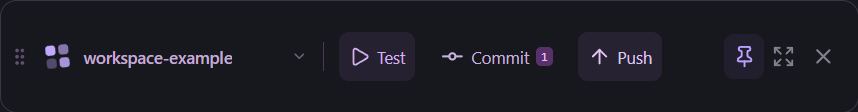

# DevDock

**English** · [简体中文](README.zh-CN.md)

A floating Windows panel for the development commands you use every day. Keep Test, Commit, Push, and your own project commands within reach while working in any editor.

Built with Electron, React, and TypeScript. No DevDock account is required. The current application interface is in Simplified Chinese.



[Main panel](docs/screenshots/panel.png) · [Commit view](docs/screenshots/commit.png). Screenshots show isolated demo projects.

## Features

- A draggable window with always-on-top mode, a compact toolbar, a system tray, and a configurable global shortcut.
- Multiple local projects, each with its own command buttons and working directories.
- Automatic discovery of Test, Build, Run, Lint, and Format scripts from `package.json`; custom commands for other tools and languages.
- Live command output, elapsed time, exit codes, completion notifications, and cancellation of Windows process trees.
- Git branch and working-tree status, file diffs, whole-file staging and unstaging, and commits from the actual Git index.
- Push, first-push upstream setup, and Fetch, with the target shown before pushing.
- A repository setup page for Git initialization, repository-local commit identity, and remote management.
- GitHub account detection, browser authorization, existing repository selection, and new empty repository creation, private by default.
- Test results associated with the Git state at the start of a run; an indication when that state has changed.
- Persistent settings and the latest 100 operations, with interrupted tasks identified after restarting.

## Requirements

- **Windows x64**. Other platforms are not currently supported.
- **Node.js 24** and npm to develop or build from source. The packaged application includes its own runtime.
- **Git** available on `PATH` for Git operations.
- **[GitHub CLI](https://cli.github.com/)** (`gh`) for the GitHub account and repository setup features. Other remotes can use your existing Git credentials or SSH keys.
- The tools and dependencies required by your project commands, such as Python, Java, or Node.js.

## Run from source

```powershell
git clone https://github.com/ActorF/DevDock.git
cd DevDock
npm ci
npm run dev
```

The renderer supports hot reload. Restart the development process after changing `electron/` or `shared/`.

To run a production build locally:

```powershell
npm run build
npm start
```

To build a portable Windows executable:

```powershell
npm run package
```

Version 0.2.0 produces `release/DevDock-0.2.0-portable.exe`. Double-click it to run without an installer; the first launch can take a few seconds. `npm run package:dir` builds the unpacked application at `release/win-unpacked/DevDock.exe`. These locally built executables are not code-signed.

## Your first project

1. Click **添加项目** (Add project), then choose a folder or enter its full path.
2. Review the detected commands, or use **添加按钮** (Add button) to enter a command such as `python -m pytest` or `mvn test`. Commands run only when clicked.
3. Click **Test** to run tests. Open **Commit** to review changes, stage files, and enter a commit message.
4. Open **Push** to check the remote and branch before pushing.
5. Use **Ctrl+Shift+Space** to show or hide the panel. Change the shortcut, window pinning, and notifications in Settings.

For a folder that is not yet a Git repository:

1. Open **仓库与账号** (Repository & account) and initialize Git.
2. Connect GitHub. DevDock detects an existing `gh` login; otherwise, start browser authorization from the panel.
3. Set your commit name and email, or select **使用 GitHub 身份** (Use GitHub identity) to use the account name and GitHub's private noreply email.
4. Select an existing repository, create an empty repository, or add a remote address manually.
5. Make a commit, then push. Creating or connecting a repository does not upload your project files.

Commit identity and GitHub credential-helper settings are written to the selected repository's local Git configuration, leaving global Git identity unchanged. GitHub credentials are managed by GitHub CLI; DevDock does not store access tokens in its JSON configuration. See the [GitHub CLI login documentation](https://cli.github.com/manual/gh_auth_login) for its authentication behavior.

## How operations behave

**Staging and commits.** Selecting a file stages the whole file; deselecting it unstages that file. Existing staged changes are retained. If a file has both staged and unstaged changes, the two versions can be viewed separately. A commit includes only the actual staged contents. DevDock checks for changes since the commit view was reviewed.

**Tests.** Success means the command exited successfully; DevDock does not infer a test-case count from arbitrary output. A changed Git state makes the previous successful test result stale. This is a reminder, not a mandatory push gate. Non-Git folders can run commands without Git-state tracking.

**Remotes.** Ahead/behind counts use the remote information already fetched locally. Fetch updates that information without merging. A connection test checks read access, including access to an empty repository; write permission is checked by an actual push. DevDock does not automatically merge or force-push. Network Git operations have timeouts and no manual stop button.

**Commands.** On Windows, command buttons use CMD, run with the current user's permissions, and inherit the application's environment. Restart DevDock after installing tools or changing `PATH`. Output is a text log, not an interactive terminal. Use the terminal shortcut for commands that require prompts or interactive input.

**Hiding and quitting.** The window's close button hides it to the tray and leaves commands running. Use the tray menu or Settings to quit; active tasks trigger a prompt. Restarting DevDock does not restart previous commands.

## Local data

Settings and operation history are stored in:

```text
%APPDATA%\DevDock\config.json
%APPDATA%\DevDock\history.json
```

Project files remain in their original folders. Removing a project from the panel only removes its saved panel configuration. Back up the two JSON files to preserve your settings and history.

History retains the latest 100 operations and the last 128 Ki characters of each operation's output. Command output can include data printed by your tools. GitHub operations, remote Git commands, and your configured commands may access the network; DevDock has no cloud synchronization service.

Writes use temporary files and atomic replacement, including support for Windows AppData redirection across drives. Invalid configuration or history is backed up before recovery. Previously running tasks are marked interrupted on the next launch.

## Development and verification

```powershell
npm run typecheck
npm test
npm run build
npm run test:smoke
npm run test:ui
npm run test:persistence
npm run test:git-setup-ui
```

- `npm test` covers Git, GitHub service behavior, command execution, persistence, and redirected storage. GitHub service tests use simulated responses.
- `test:smoke` exercises the Electron application with temporary projects, a separate profile, and local bare Git remotes.
- `test:ui` checks actual button interactions, including failed commits and retained drafts.
- `test:persistence` uses an isolated profile under the real Windows AppData location to check folder selection and persistence across restarts.
- `test:git-setup-ui` checks repository initialization, identity, and remote management through the interface.

These checks do not push to your repositories. Some checks briefly display windows; screenshots go to the ignored `artifacts/screenshots/` directory. To check an unpacked build, set the following variable before running the Electron checks:

```powershell
$env:DEVDOCK_TEST_EXECUTABLE = "$PWD\release\win-unpacked\DevDock.exe"
```

### Manual acceptance

After `npm run package`, run:

```powershell
npm run prepare:manual
npm run test:manual-preflight
```

The generator creates a new isolated suite beside the source directory: 10 project folders, 8 preloaded projects and 2 examples to add manually, 5 profiles, launchers, and an HTML checklist with 82 checks. The checklist saves results locally and can export them. A new suite does not overwrite an earlier suite or your normal profile.

Most checks use local Git remotes. Optional GitHub checks require an account and network access. See the [manual acceptance checklist](docs/manual-acceptance.md), currently in Chinese. Recovery and history-capacity samples are labeled synthetic data, not records of commands actually executed.

The separate `node scripts/github-live-validation.mjs --live` workflow requires an authenticated GitHub CLI account and creates a private test repository for real network operations, including pushes. It is deliberately excluded from ordinary test commands. Local evidence is written to `artifacts/github-validation.json` and is not committed to this repository.

## Project layout

```text
electron/main.ts       Windows, tray, notifications, and IPC
electron/preload.ts    Restricted renderer bridge
electron/services/    Git, GitHub, command execution, and persistence
renderer/             React interface and styles
shared/types.ts       Types shared by the main process and renderer
tests/                Service and integration tests
scripts/              Development, packaging, and acceptance tools
docs/                 Screenshots and manual acceptance checklist
```

The renderer runs with sandboxing and context isolation, without Node.js access. Git operations use argument arrays rather than inserting commit messages into shell commands. Custom command buttons intentionally execute the shell commands you configure.

## Current scope

DevDock 0.2.0 supports Windows x64 and a Chinese interface. The GitHub picker lists up to 100 recently updated repositories owned by the signed-in account; other repository addresses can be entered manually. There is no automatic updating, line-by-line staging, conflict editor, automatic merging, cloud synchronization, or plugin marketplace.

Bug reports and focused contributions are welcome through [GitHub Issues](https://github.com/ActorF/DevDock/issues) and pull requests.

## License

[MIT](LICENSE).
